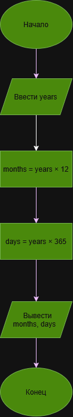

# Лабораторная работа №3

## Вариант 16

### Условие задачи

Написать и отладить программу пересчета числа прожитых лет в дни и месяцы.

## Обозначения

- `years` — количество прожитых лет;
- `months` — количество прожитых месяцев;
- `days` — количество прожитых дней.

## Формулы

Для перевода количества лет в месяцы используется формула:

months = years * 12

Для перевода количества лет в дни используется формула:

days = years * 365

## Алгоритм

1. Ввести количество прожитых лет `years`.
2. Вычислить количество месяцев `months`.
3. Вычислить количество дней `days`.
4. Вывести полученные значения.

## Блок-схема



## Код программы

```c
#include <stdio.h>

int main()
{
    int years, months, days;

    printf("Введите количество прожитых лет: ");
    scanf("%d", &years);

    months = years * 12;
    days = years * 365;

    printf("Количество месяцев: %d\n", months);
    printf("Количество дней: %d\n", days);

    return 0;
}
```

## Проверка программы

Входные данные:

```text
18
```

Расчет:

```text
months = 18 * 12 = 216
days = 18 * 365 = 6570
```

Результат работы программы:

```text
Количество месяцев: 216
Количество дней: 6570
```

## Вывод

В ходе выполнения лабораторной работы была разработана программа на языке C для пересчета количества прожитых лет в месяцы и дни. Программа получает количество лет, выполняет необходимые арифметические операции и выводит полученные результаты.

## Разработчик

Орлов Даниил, группа БИЦТ-262
